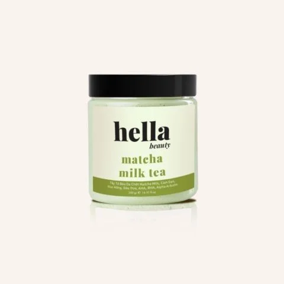

# BTCN-PTUD
Đây là bài tập cá nhân môn Phát triển ứng dụng Thương mại điện tử tại Đại học UEH. Nội dung bao gồm quá trình khảo sát, phân tích và đánh giá website thương mại điện tử, ứng dụng AI hỗ trợ thực hiện bài tập, thiết kế và phát triển giao diện website bằng HTML/CSS, cũng như quản lý và triển khai dự án trên GitHub. 

E-commerce UI Improvement – Hella Beauty
1. Giới thiệu
Đây là dự án giao diện website thương mại điện tử Hella Beauty, tập trung vào khu vực tìm kiếm và khám phá sản phẩm mỹ phẩm, chăm sóc cá nhân. Giao diện demo có ô tìm kiếm, từ khóa gợi ý, khu vực lịch sử tìm kiếm và danh sách các sản phẩm phổ biến.

Mục tiêu là giúp người dùng dễ tìm kiếm và nhận diện sản phẩm, đồng thời xây dựng bố cục phù hợp với màn hình máy tính và điện thoại.
2. Website tham khảo
- Tên website: Hella Beauty
- URL: https://hellabeauty.vn/
- Khu vực đã khảo sát: Trang chủ, danh mục sản phẩm, chi tiết sản phẩm, tìm kiếm và giỏ hàng; tập trung cải tiến khu vực tìm kiếm sản phẩm.
Qua khảo sát, em lựa chọn làm nổi bật ô tìm kiếm, bổ sung từ khóa gợi ý, khu vực lịch sử tìm kiếm và danh sách sản phẩm để người dùng dễ tham khảo.
3. Chức năng
- Hiển thị danh sách 6 sản phẩm mẫu thuộc các nhóm chăm sóc tóc, làm sạch da và chăm sóc cơ thể.
- Hiển thị hình ảnh, tên, danh mục, mô tả ngắn và giá của từng sản phẩm.
- Có ô nhập từ khóa, nút Tìm kiếm và các từ khóa tìm kiếm gợi ý.
- Có khu vực giao diện dành cho lịch sử tìm kiếm.
- Có nút Xem chi tiết và Thêm vào giỏ trên mỗi thẻ sản phẩm.
- Bố cục responsive: hiển thị 3 cột sản phẩm trên màn hình rộng và 2 cột trên màn hình nhỏ theo CSS hiện có.
Lưu ý: Đây là giao diện demo, không có backend hoặc cơ sở dữ liệu. Việc nút “Xem chi tiết” có mở thông tin sản phẩm hay không phụ thuộc vào xử lý trong script.js; không mặc định coi đây là chức năng hoàn chỉnh chỉ vì nút đã hiển thị.
4. Công nghệ
- HTML5: Tạo cấu trúc trang, biểu mẫu tìm kiếm và các thẻ sản phẩm.
- CSS3: Định dạng màu sắc, hình ảnh, nút bấm, bố cục Grid/Flexbox và responsive bằng Media Queries.
- JavaScript thuần: Được liên kết qua script.js để hỗ trợ các tương tác giao diện. Không sử dụng framework hoặc backend.
5. Cách chạy
1. Tải hoặc sao chép thư mục dự án về máy tính.
2. Đảm bảo index.html, styles.css và script.js nằm đúng vị trí; các ảnh sản phẩm nằm trong thư mục image/.
3. Mở tệp index.html bằng trình duyệt Google Chrome hoặc trình duyệt hiện đại khác.
4. Kiểm tra hình ảnh, thông tin sản phẩm, ô tìm kiếm và các nút thao tác.
5. Nhấn F12 → Toggle device toolbar (hoặc Ctrl + Shift + M) để thử giao diện ở nhiều kích thước màn hình, ví dụ 360px và màn hình desktop.
6. Cải tiến đã thực hiện
6.1. Thay ảnh và đồng bộ thông tin sản phẩm
Vấn đề ban đầu: Ảnh trên giao diện do AI tạo chỉ mang tính minh họa; một số tên sản phẩm, mô tả, danh mục và từ khóa tìm kiếm chưa phù hợp với hình ảnh thực tế.

Cách chỉnh sửa: Em thay ảnh minh họa bằng ảnh sản phẩm thực tế lưu tại thư mục image/, thay đường dẫn trong thuộc tính src của thẻ , đồng thời cập nhật alt, data-name, data-keywords, tên sản phẩm, product-category và product-description tương ứng.

Ví dụ:
<article class="product-card"
         data-name="Tẩy tế bào chết Body"
         data-keywords="tay te bao chet body">
  

    
  

</article>
-  hiển thị ảnh; src chỉ đường dẫn đến tệp ảnh (image/ là thư mục, tay-te-bao-body.webp là tên tệp và định dạng).
- alt mô tả ảnh bằng văn bản.
- data-name và data-keywords lưu dữ liệu tên và từ khóa phục vụ việc tìm kiếm bằng JavaScript.
- product-category và product-description là các class CSS dùng để định dạng danh mục và mô tả; nội dung hiển thị được chỉnh trực tiếp trong HTML.
6.2. Thêm nút “Xem chi tiết”
Vấn đề ban đầu: Mỗi sản phẩm chỉ có nút “Thêm vào giỏ”, chưa có lựa chọn “Xem chi tiết”.

Cách chỉnh sửa: Em bổ sung nút mới phía trên nút “Thêm vào giỏ” và thiết kế nền hồng, chữ trắng, khác với nút viền hồng bên dưới.

HTML:
<button class="btn btn-detail" type="button" data-product="Dầu gội Bưởi">
  Xem chi tiết
</button>
CSS:
.btn-detail {
  width: 100%;
  margin-bottom: 10px;
  background-color: var(--pink);
  color: white;
  border: 1px solid var(--pink);
}

.btn-detail:hover {
  background-color: var(--pink-dark);
  color: white;
}

@media (max-width: 520px) {
  .btn-detail {
    font-size: 12px;
    padding: 10px 6px;
    margin-bottom: 8px;
  }
}
- <button> tạo nút; type="button" giúp nút không tự gửi biểu mẫu.
- btn là kiểu chung, btn-detail là class áp dụng CSS riêng.
- data-product lưu tên sản phẩm để có thể sử dụng khi viết xử lý JavaScript.
- width, margin-bottom, background-color, color và border quy định kích thước, khoảng cách và màu sắc.
- :hover thay đổi màu khi di chuột; @media điều chỉnh hiển thị trên màn hình nhỏ.
Kết quả: Giao diện thẻ sản phẩm trực quan và đồng bộ hơn. Phần đã thực hiện và xác nhận ở đây là hiển thị và định dạng nút; chưa khẳng định chức năng mở chi tiết sản phẩm đã hoạt động.
7. Hỗ trợ từ AI
Em sử dụng ChatGPT để hỗ trợ phân tích giao diện website tham khảo, đề xuất cấu trúc khu vực tìm kiếm, tạo mã nguồn demo HTML/CSS/JavaScript, giải thích các thành phần mã và tìm nguyên nhân lỗi CSS.

Sau khi nhận kết quả từ AI, em tự xem lại giao diện, thay ảnh minh họa bằng ảnh sản phẩm thực tế, chỉnh tên/danh mục/mô tả/từ khóa cho đồng bộ và thêm nút “Xem chi tiết”. Em cũng kiểm tra giao diện trên máy tính và bằng Chrome DevTools ở chế độ mô phỏng điện thoại. 
